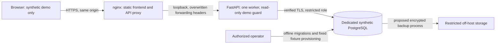

# Sprint 15: synthetic demonstration deployment architecture

Design date: 2026-10-28. **No hosted deployment or cloud infrastructure provisioning performed.** Isolated loopback test servers and synthetic databases were used only for verification. This release provides a local verified demonstration path and operator-reviewed hosting templates, not authorization to collect real health records. Read [readiness](DEPLOYMENT_READINESS.md), [runbooks](OPERATIONS_RUNBOOK.md), [Sprint 14 security](SECURITY_PRIVACY_AUDIT.md) and [research gates](RESEARCH_READINESS_GATE.md).

## Recommended starting point

Prefer an existing institution-managed Linux host and PostgreSQL service if the institution can supply ownership, patching, DNS/TLS and storage controls. One hostname serves the built React frontend and proxies `/api/` to a single loopback-only FastAPI worker. This avoids separate frontend/backend hosting accounts, cross-site cookies and an additional network ingress. Use a separate database exclusively for generated fixtures. No cloud account, free tier, credit card, VM, budget or available institutional service is assumed. If those resources are unavailable, keep the demonstration on localhost; do not bypass safeguards to obtain a public URL. No price or uptime guarantee is asserted.

| Component | Proposed arrangement | Boundary / unresolved prerequisite |
| --- | --- | --- |
| Frontend | `npm ci` and Vite build with `VITE_DATA_MODE=synthetic`, empty `VITE_API_URL`; nginx serves `frontend/dist` | Immutable release directory; no Vite dev/preview server on public ingress. Browser build variables are public, never secrets. |
| TLS/ingress | Institution-managed nginx, one approved DNS name and certificate, HTTPS only | Only 443 public; HTTP rejected; firewall and certificate renewal owned by operator. CSP and full nginx execution remain to be verified on the selected host. |
| API | `python -m app.serve`, single worker, bound to `127.0.0.1:8015` | Only same-host proxy is trusted for forwarded scheme/IP. Never expose this listener externally or trust `*`. In-process throttling is not distributed protection. |
| Database | Separate PostgreSQL database ending `_synthetic_demo`, authenticated TLS with `sslmode=verify-full` | Prefer an existing managed private service; otherwise an operator must maintain it. Restrict network access; do not reuse app/private/research databases. No PostgreSQL service was provisioned or TLS-tested here. |
| Secrets | Root-controlled environment/service files or approved secret manager, not Git or build output | Separate migration/provisioning owner, restricted runtime and backup roles; demo password entered privately and removed from provisioning environment afterward. |
| Persistent storage | PostgreSQL durable storage; root-owned versioned releases; restricted encrypted backup destination | No persistent uploads. Local SQLite demo is isolated under ignored `.research/`; it is not a hosted production database. Storage encryption/retention are proposed, not operational. |
| Monitoring | Internal status probes plus fixed operational event codes | No request/response payload, path/query, account, cookie, credential or token collection; no external health telemetry. Named on-call/incident owner is still needed. |

The backup arrow is a design, not an installed job. Existing root [compose.yaml](../compose.yaml) remains a local-development PostgreSQL convenience; it has no configured database TLS/backup operations and must not be promoted unchanged to hosted service.

## Environment separation

| Environment | Settings and data | Readiness interpretation |
| --- | --- | --- |
| Local development | `APP_ENV=development`, `DATA_MODE=local`; loopback HTTP and isolated synthetic test/dev data | Existing editable workflows preserved. Still no permission for real health records. Never expose this mode publicly. |
| Local synthetic rehearsal | Development transport, `DATA_MODE=synthetic`, acknowledgement and dedicated SQLite filename | Exercises the same read-only demo boundary with synthetic fixtures; does not verify internet TLS/proxy/PostgreSQL. |
| Hosted staging | `APP_ENV=production`, synthetic-only mode, separate hostname/database/secrets and no real users | Must satisfy production security settings and execute host/restore smoke tests before exposure. No shared sessions/database with a demonstration release. |
| Hosted demonstration (“production” configuration) | Same strict synthetic-only policy, dedicated release and database | Production is a transport/configuration profile, **not** clinical or real-data approval. This release intentionally rejects production `DATA_MODE=local` or missing mode. |

All synthetic-mode deployments require `DEMO_ACKNOWLEDGEMENT=synthetic-only-no-real-health-data`. Production also requires explicit exact HTTPS origins, valid allowed hosts and PostgreSQL certificate/hostname verification. The checked-in [environment template](../deploy/demo.env.example) deliberately leaves the database URL empty so it cannot start unchanged. SQLite demo paths must have the basename `migramind-synthetic-demo.sqlite`; versioned parent directories keep resets separate. PostgreSQL names may be versioned provided they end `_synthetic_demo`.

## Synthetic-data safeguards and limits

Migration `009` adds an **empty** `demo_deployments` table. It does not copy, modify or certify existing records. The explicit `app.demo provision` command refuses any nonempty application table, inserts one reserved `demo@synthetic.example.test` account and a fixed fictional fixture, and writes a fixture-version marker in the same transaction. There are no import, clear, reset or overwrite commands. Do not use legacy `seed.py`, whose unassigned editable records are not the deployment fixture.

Demo startup requires the current migration, exact fixture marker and only the reserved synthetic account. The same check guards API access after startup. Registration, account/health/contact mutations and deletion are rejected by the middleware before request-body consumption. Missing profile/support defaults fail with 503 rather than being created by GET requests. Login never rehashes demo user records; only session creation, expiry cleanup and logout may write during normal demo requests. Only login/logout and explicitly consented read-only research-export POSTs are allowed; reads retain existing authentication and ownership checks. The optional PostgreSQL [runtime-role template](../deploy/demo-role.sql.example) further restricts writes to login sessions. The owner role must never be used by the running API.

The built demo frontend displays its warning even when the backend is unavailable, fixes the login identity, hides registration, refuses to attach to a non-demo backend and rejects health mutations before upload. The backend independently enforces read-only behavior against direct requests. Ordinary development builds retain editable behavior. Forms may still be browsed; the warning says not to type real information. This is not a semantic classifier: malicious clients can transmit bytes, and a privileged operator could manually introduce data. No software can prove that arbitrary human input is fictional. Network/host access, human instructions, restricted accounts and no ingestion/import path are all necessary.

The fixture contains three dated January 2026 daily states (migraine, explicit no migraine, unknown) and one explicitly fictional episode. Timestamps retain the actual fixture creation time and backdated event dates; they are retrospective synthetic examples, not clinical evidence. Current-month summaries may honestly be empty. UI/API headers and exports label synthetic mode; outcome verification/training eligibility remain false. No unvalidated risk score, model endpoint activation or future research enrollment is introduced. Shared demo credentials are only for fixture viewing and must never be reused as personal passwords.

## Packaging, network and operational boundaries

Use versioned release directories and reviewed lockfiles, not `git pull` in a live working tree. Runtime templates: [service](../deploy/migramind-demo.service.example), [proxy](../deploy/nginx-demo.conf.example), [frontend build environment](../deploy/frontend.env.example). Dependencies are locked, but a bit-for-bit reproducible OS/runtime image is **not** claimed. Record exact reviewed OS, Python, Node/npm and release/artifact hashes; test the selected Linux platform. The local verification environment uses Python 3.13.11, Node 22.17.1 and npm 11.5.1; these are evidence of what was exercised, not a statement that those runtime builds are a current hosted security baseline. Review supported patched runtimes before hosting.

The [nginx proxy module documentation](https://nginx.org/en/docs/http/ngx_http_proxy_module.html) describes the proxy/header controls used by the template. It overwrites forwarding headers, disables request access logs/caching, limits request size/rate and serves a same-origin CSP. The launcher's trusted proxy is exactly loopback, with one worker. A multi-host/container/load-balancer topology requires a new explicit trust configuration and tests; do not copy these loopback assumptions into it.

[PostgreSQL TLS guidance](https://www.postgresql.org/docs/17/ssl-tcp.html) describes server-side TLS and certificate management; application URL validation does not configure that server, its CA trust, firewall or encrypted storage. Database connection/pool acquisition and readiness statements have bounded timeouts, but no load/SLA guarantee has been measured. Readiness checks schema version `009`, marker and reserved identity, without revealing database details.

No containers are required for this approach. Docker exists on this workstation but its daemon is unavailable; nginx/systemd are not available for host execution. Their templates and SQL role grants have static checks only. Full Linux/TLS/PostgreSQL/role/backup validation is an explicit hosted-readiness blocker, not a passed deployment test.
