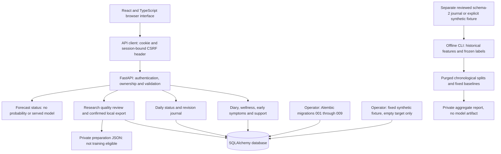

# MigraMind project architecture

Sprint 17 source review, 2026-10-30. MigraMind is a migraine diary, support-preference and research-readiness prototype. Its React/TypeScript interface and FastAPI API do not serve a forecasting model. This document describes the checked-in implementation; hosting arrangements are proposals. Claim-level references and test locations are in the [evidence matrix](PROJECT_EVIDENCE_MATRIX.md).

## Components and boundaries

The preparation download and offline schema-2 input are intentionally separate nodes: there is no automatic conversion into verified outcomes or research consent. The offline pipeline has no serving connection to FastAPI. The diagram omits session tables and response middleware for readability; those boundaries are described below.

## Frontend and request lifecycle

[bootstrap.tsx](../frontend/src/bootstrap.tsx), [Authentication.tsx](../frontend/src/Authentication.tsx) and [main.tsx](../frontend/src/main.tsx) provide the application entry, authentication gate and workspace. Vite builds React/TypeScript with Tailwind styles. Focus/navigation, warm/dark palettes and Attack Mode support a mobile-oriented experience; selected automated accessibility checks do not certify usability or WCAG compliance.

[api.ts](../frontend/src/api.ts) sends credentials with requests, retains the CSRF token in module memory, rejects stale session responses and gates synthetic mutations before upload. Authentication tokens are not stored in browser local storage. Appearance preferences are device-local. The synthetic build checks the backend's demo-mode response before opening the workspace.

## Authentication, persistence and migrations

[main.py](../backend/app/main.py) constructs FastAPI, SQLAlchemy models/engine and request-scoped database sessions, then registers tracking, support, prospective and research-quality routes. [auth.py](../backend/app/auth.py) hashes passwords with Argon2id and stores digests of opaque session tokens in `login_sessions`. Cookies are HttpOnly and SameSite=Lax; production uses a Secure `__Host-` cookie. Login rotates sessions; logout revokes them. Protected reads require the mounted session's CSRF header; mutations also require an allowed Origin. Server-side owner filters apply to records, references and exports. Unclaimed pre-authentication rows are preserved and hidden rather than assigned to the first account.

SQLite is the local fallback. PostgreSQL configuration is supported, but hosted PostgreSQL operation remains unverified in the deployment records. [Alembic versions](../backend/alembic/versions) contain migrations 001-009: initial tracking, assistance, richer tracking, adaptive support, authentication/ownership, SOS preferences, pattern observations, prospective collection and the demo marker. Filename `004_adaptive_support.py` is not the authentication migration; authentication is `005_authentication_privacy.py`. Use migrations explicitly; API startup does not replace schema migration. Destructive downgrades are restricted where data loss would occur.

## Diary and prospective observations

Diary episodes preserve optional severity, exact start/end where supplied, timezone, symptoms and notes. Unknown end times and legacy dates do not acquire invented timestamps. Wellness and early symptoms are separate observations. Attack-session button times are assistance activity, not biological onset/recovery. Descriptive insights do not establish causal triggers.

[prospective.py](../backend/app/prospective.py) manages a separate daily report with migraine, no migraine or unknown status, optional numeric measures, source-local date/timezone and reported event/observation times. Server availability is assigned by the backend. Creation, correction and deletion insert journal revisions; optimistic expected-revision checks reject stale writes. Deletion leaves a tombstone in private history until account erasure. An explicit no-migraine report made before the day ends is provisional and needs later confirmation; absent dates and unknown reports never become negatives.

Revision awareness applies to these daily check-ins, not all legacy diary/wellness/early-symptom records. Application journals are not administrator-proof. A final current-state export cannot reconstruct missing past versions.

## Research preparation and offline evaluation

[research_quality.py](../backend/app/research_quality.py) reviews completed source-local days, missing/unknown/conflicting observations and journal integrity. Its scoped export requires explicit per-download confirmation, remains owner-isolated and excludes free text, identity/contact fields, deleted chains and unverifiable histories. It is private health data, not automatically de-identified. Download confirmation and support-sharing consent do not constitute research enrollment. The response explicitly has no outcome revisions and is not training eligible.

The administrative [Sprint 9 adapter](../backend/research/sprint9_adapter.py) is read-only and emits no verified outcomes. The [revision-aware offline baseline](ML_RESEARCH_BASELINE.md) instead requires a strict single-account schema-2 journal with reviewed provenance and independent outcome evidence. Features use versions available strictly before the cutoff; labels and eligibility use a bounded historical freeze. Fixed-grid chronological partitions purge horizons and label availability crossing boundaries. Preprocessing fits on train only. Models are discarded after reporting, with no model serialization or runtime integration. See [methodology](RESEARCH_PRESENTATION.md) for precise target and evaluation definitions.

## Synthetic demonstration and security

[demo.py](../backend/app/demo.py) provisions one reserved fictional account, one episode and three January 2026 daily states only into an empty dedicated migrated target. Migration 009 adds an empty marker table; it does not certify old records. [deployment.py](../backend/app/deployment.py) verifies schema/marker/account at startup and on guarded API access. Middleware denies mutations before body consumption except login, logout and confirmed read-only research-export POSTs. Session writes remain necessary; read-only refers to demonstration records. A marker cannot prove arbitrary operator-inserted content is fictional.

[security.py](../backend/app/security.py) validates origins/hosts and production configuration, sanitizes errors and applies private response headers. Production configuration requires synthetic mode, HTTPS origins and PostgreSQL `sslmode=verify-full`; this validation does not configure infrastructure. The proposed single-host deployment serves built static files behind nginx, proxies to one loopback FastAPI worker and uses a dedicated synthetic database. Liveness is database-independent; readiness checks the schema and demo identity without exposing connection details. Logs are restricted to fixed operation events in this boundary; infrastructure logging needs its own review.

See [deployment architecture](DEPLOYMENT_ARCHITECTURE.md), [readiness](DEPLOYMENT_READINESS.md), [operations](OPERATIONS_RUNBOOK.md), [security audit](SECURITY_PRIVACY_AUDIT.md) and [product review](PRODUCT_QUALITY_REVIEW.md). Hosted Linux/nginx/systemd, PostgreSQL TLS/roles, encrypted off-host recovery and operational sign-off remain open. Authentication throttling is process-local. Managed retention, recovery/MFA, independent security/privacy review and real-data authorization remain gaps. No deployment or real health-data collection is part of this sprint.
